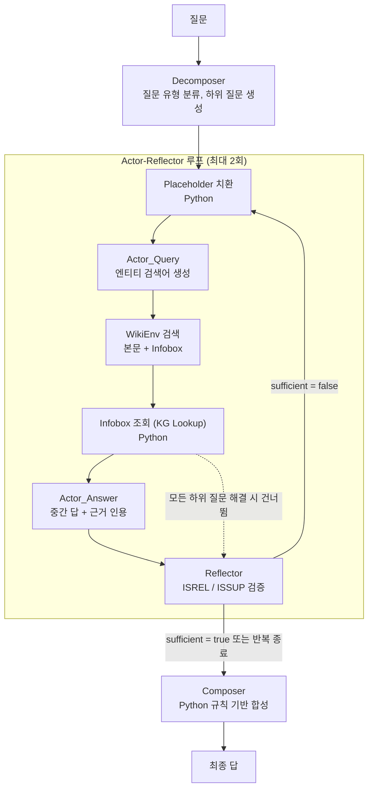

# 2WikiMultiHopQA Multi-Agent QA System

연세대학교 CAS3301 자연어처리(2026-1) 과제로 구현한 멀티홉 질의응답 시스템입니다. Llama-3.2-3B-Instruct 기반의 LLM 에이전트 4개와 결정론적 Python 모듈을 결합해 [2WikiMultiHopQA](https://aclanthology.org/2020.coling-main.580/) 질문에 답합니다.

dev 앞 100문항 기준으로 **EM 48.0 / F1 53.1**을 기록했으며, 단일 에이전트 baseline(EM 28.0 / F1 33.5)보다 EM이 20포인트 높습니다.

## 시스템 구조



| 구성 요소 | 종류 | 역할 |
|---|---|---|
| Decomposer | LLM | 질문을 4개 유형 중 하나로 분류하고, 의존 순서대로 하위 질문을 한 번에 생성합니다. 아직 모르는 엔티티는 `[director of X]` 형태의 placeholder로 표시합니다. |
| Actor_Query | LLM | placeholder가 해결된 하위 질문에 대해 Wikipedia 검색어를 만듭니다. 검색어에는 속성 단어 없이 엔티티 이름만 넣습니다. |
| Actor_Answer | LLM | 검색 근거를 읽고 하위 질문별 답과 인용문을 출력합니다. 근거가 없으면 `null`을 반환합니다. |
| Reflector | LLM | 근거 관련성(ISREL)과 답의 뒷받침 여부(ISSUP)를 확인해 루프 종료 여부를 판단합니다. |
| KG Lookup | Python | 이미 받아 온 페이지의 infobox에서 출생일, 감독, 배우자 같은 속성을 직접 추출합니다. 값이 있으면 LLM 답보다 우선합니다. |
| Composer | Python | `comparison`과 `bridge_comparison`은 규칙으로 답을 계산하고, 나머지 유형은 Actor_Answer의 답을 사용합니다. |

Python 모듈은 에이전트 수에 포함하지 않습니다. 모든 LLM 호출은 `temperature = 0`으로 실행합니다.

## 실험 결과

아래 결과는 모두 dev 앞 100문항에 대한 값입니다.

### 전체 성능

| 설정 | Phase 1 EM / F1 | Phase 2 EM / F1 |
|---|---|---|
| Single Agent | 28.0 / 34.0 | - |
| **Full System** | 45.0 / 49.0 | **48.0 / 53.1** |
| w/o Decomposer | 18.0 / 21.0 | 28.0 / 33.0 |
| w/o Reflector | 22.0 / 24.0 | 30.0 / 33.0 |
| w/o Few-shot | 23.0 / 30.0 | 19.0 / 23.0 |

Phase 1은 프롬프트 설계만 적용한 구성이고, Phase 2는 여기에 KG Lookup을 더한 최종 구성입니다. 표는 보고서 Table 1의 값을 옮긴 것이며, Single Agent의 F1은 보고서에서 34.0, `outputs/results.csv`에서 33.47입니다.

### 질문 유형별 성능

`outputs/`의 최종 실행 결과를 `data/dev.json`의 정답 유형별로 집계한 값입니다.

| 유형 | 문항 수 | Single EM / F1 | Multi EM / F1 |
|---|---:|---:|---:|
| comparison | 32 | 43.8 / 47.2 | 87.5 / 87.5 |
| bridge_comparison | 18 | 66.7 / 69.3 | 72.2 / 72.2 |
| compositional | 28 | 3.6 / 3.6 | 14.3 / 25.0 |
| inference | 22 | 4.5 / 22.2 | 13.6 / 23.1 |

규칙으로 답을 계산하는 두 유형은 성능이 높지만, 마지막 hop을 LLM과 검색 결과에 의존하는 `compositional`과 `inference`는 여전히 낮습니다. Decomposer의 유형 분류 정확도는 81%입니다.

## 실행 방법

### 요구 사항

- Conda, Python 3.10.16
- Linux, macOS 또는 WSL: 문항별 타임아웃에 `signal.SIGALRM`을 사용하므로 Windows 네이티브 Python에서는 실행되지 않습니다.
- 연세대학교 교내망 또는 VPN: 추론 서버 접속에 필요합니다.
- 인터넷 연결: Wikipedia를 실시간으로 검색합니다.

### 설치

```bash
bash script/setup.sh
conda activate Agent
```

### 서버 설정

`conf.d/agent.yaml`의 `base_url`을 학번 끝자리에 맞게 지정합니다. API 키는 `"EMPTY"`를 그대로 사용합니다.

| 학번 끝자리 | `base_url` |
|---|---|
| 1, 3, 5, 7, 9 | `http://165.132.142.56:8005/v1` |
| 0, 2, 4, 6, 8 | `http://165.132.142.56:8006/v1` |

### 실험 실행

`script/run_2wikiqa.sh`는 `모드`와 `출력 경로`를 인자로 받습니다. 인자를 생략하면 최종 구성을 실행해 `outputs/2wiki_predictions_multi.json`에 저장합니다.

```bash
bash script/run_2wikiqa.sh
```

```bash
bash script/run_2wikiqa.sh single_agent outputs/2wiki_predictions_single.json
```

```bash
bash script/run_2wikiqa.sh without_decomposer outputs/ablation_without_decomposer.json
```

| 모드 | 설명 |
|---|---|
| `multi_agent_structured` | 최종 구성 (Phase 2) |
| `single_agent` | 검색과 분해 없이 LLM을 한 번만 호출하는 baseline |
| `without_decomposer` | 분해 없이 원래 질문으로 바로 검색 |
| `without_reflector` | Reflector를 제거하고 루프를 1회만 실행 |
| `without_cot_prompting` | 모든 에이전트의 few-shot 예시 제거 |
| `multi_agent_without_structured_prompting` | 모든 역할에 비구조화 프롬프트 사용 (보고서 미수록) |

### 결과 요약과 분석

```bash
python src/make_csv.py --single outputs/2wiki_predictions_single.json --multi outputs/2wiki_predictions_multi.json --output outputs/results.csv
```

`make_csv.py`는 single과 multi 결과만 CSV로 묶습니다. 예측 결과를 문항별로 확인하려면 다음 스크립트를 사용합니다. 두 번째 명령의 마지막 인자는 문항 번호이며, 생략하면 전체를 출력합니다.

```bash
python peek.py outputs/2wiki_predictions_single.json
```

```bash
python peek_multi.py outputs/2wiki_predictions_multi.json 0
```

## 프로젝트 구조

```text
├── conf.d/
│   ├── agent.yaml               # 모델, 서버, 생성 파라미터
│   └── 2wikiqa.yaml             # 태스크 설정, 역할별 few-shot 예시
├── data/dev.json                # 2WikiMultiHopQA dev (300문항, 유형별 75개)
├── script/
│   ├── setup.sh                 # Conda 환경 생성
│   └── run_2wikiqa.sh           # 실험 실행
├── src/
│   ├── agent/
│   │   ├── agents.py            # LLM 호출, 재시도 처리
│   │   └── prompts/
│   │       ├── prompt.py        # 시스템 프롬프트, PROMPT_REGISTRY
│   │       └── construct_message.py
│   ├── run_2wikiqa.py           # 파이프라인, ablation 모드, 평가 루프
│   ├── utils.py                 # placeholder 치환, Composer, KG Lookup
│   ├── wikienv.py               # Wikipedia 검색, infobox 추출, 캐시
│   ├── wrappers.py              # 데이터 로드, EM/F1 계산, 궤적 기록
│   └── make_csv.py              # 결과 CSV 생성
├── peek.py, peek_multi.py       # 결과 확인 스크립트
└── HANDOFF.md, 오늘의_변경지점.md  # 개발 당시의 작업 기록
```

`outputs/`와 `trajs/`는 실행 시 생성되며 Git에서 제외됩니다. 두 작업 기록은 작성 시점의 내용이라 현재 코드와 다른 부분이 있습니다. (예: `EVIDENCE_TRUNCATE_CHARS`)

## 참고 문헌

- Ho et al. (2020). *Constructing A Multi-hop QA Dataset for Comprehensive Evaluation of Reasoning Steps.* COLING.
- Asai et al. (2024). *Self-RAG: Learning to Retrieve, Generate, and Critique through Self-Reflection.* ICLR.
- Trivedi et al. (2023). *Interleaving Retrieval with Chain-of-Thought Reasoning for Knowledge-Intensive Multi-Step Questions.* ACL.
- Wang et al. (2023). *Plan-and-Solve Prompting: Improving Zero-Shot Chain-of-Thought Reasoning by Large Language Models.* ACL.
- Yao et al. (2022). *ReAct: Synergizing Reasoning and Acting in Language Models.* arXiv:2210.03629.
- Zhou et al. (2022). *Least-to-Most Prompting Enables Complex Reasoning in Large Language Models.* arXiv:2205.10625.
